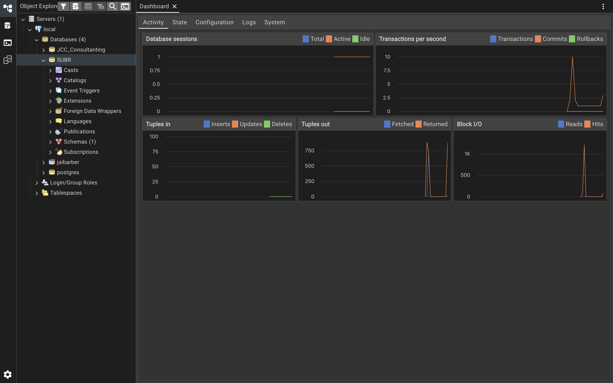
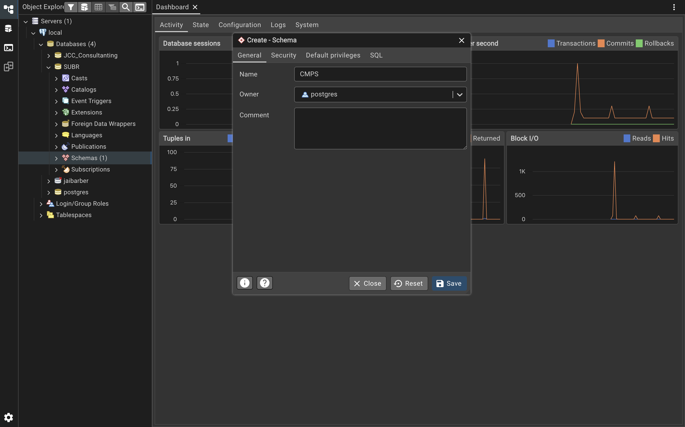
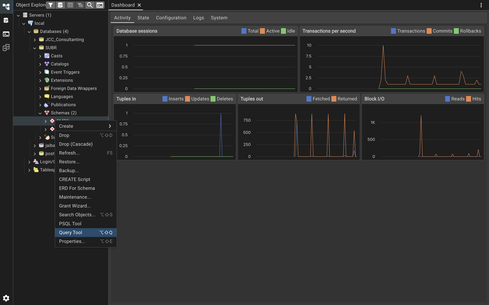
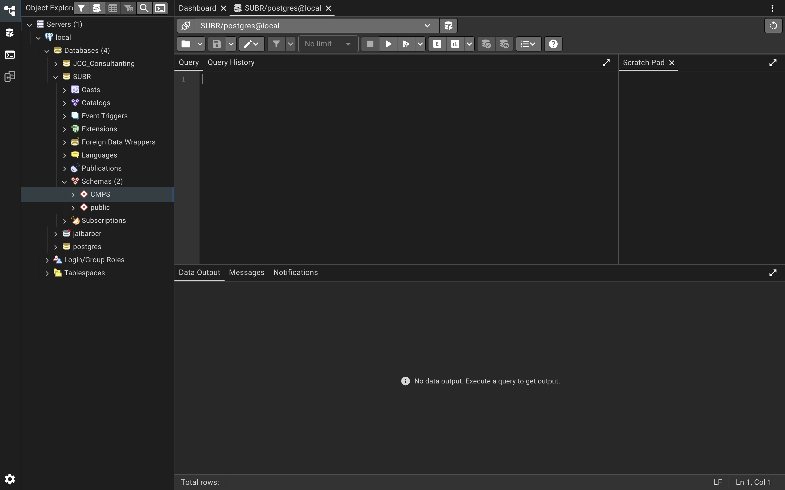
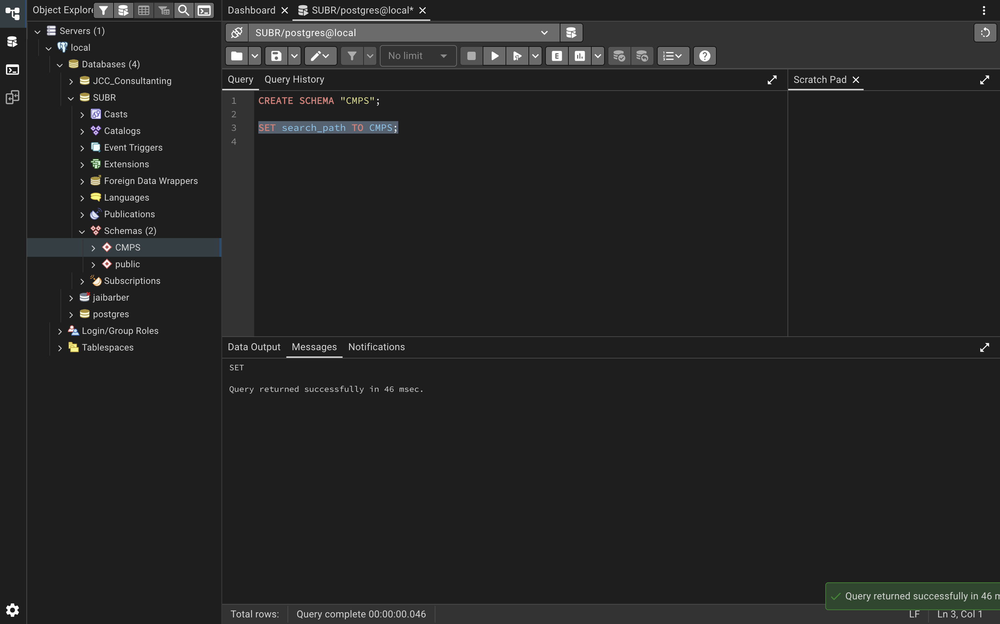
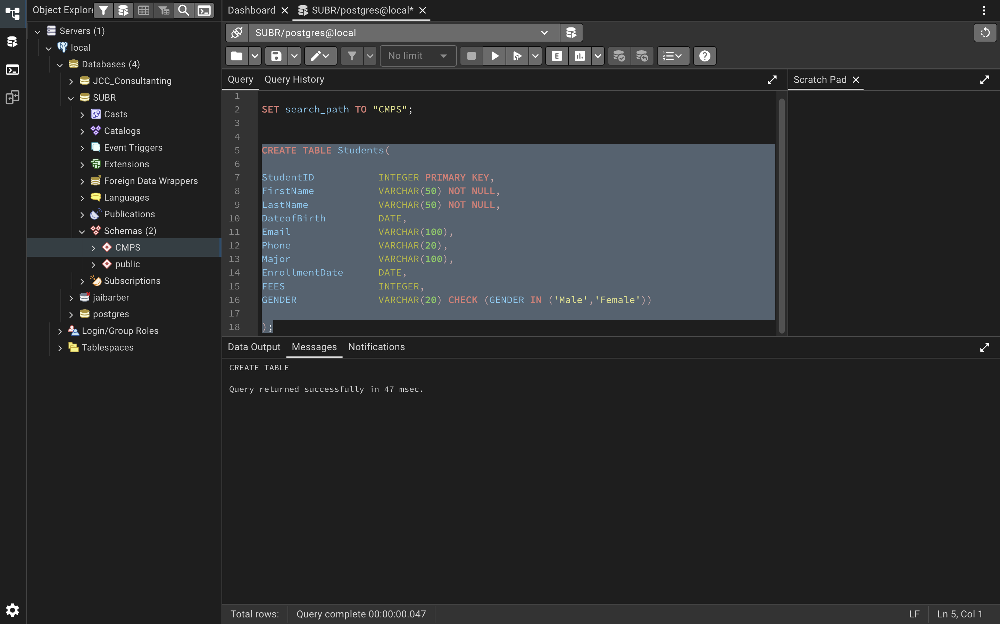
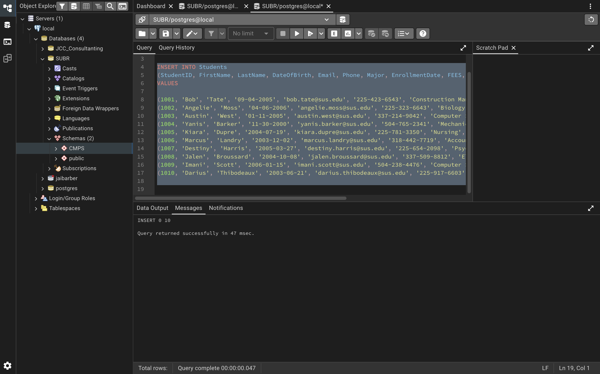
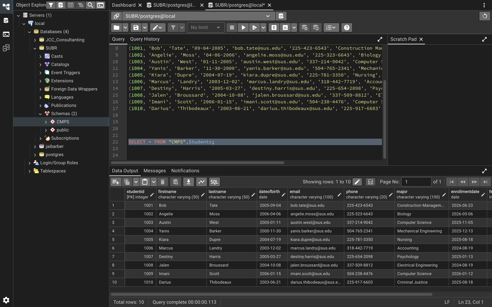
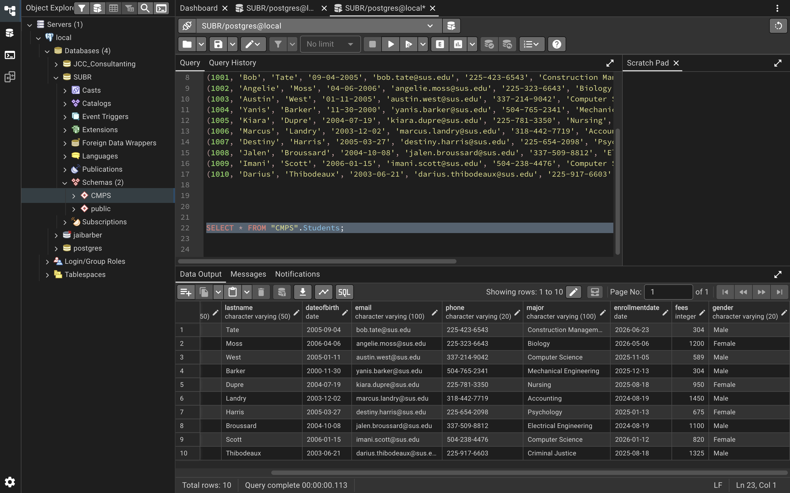
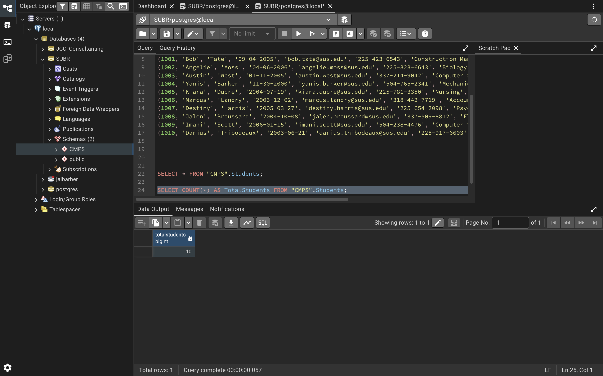

# Project 1 — Student Database (SUBR / CMPS)

Building a `Students` table in PostgreSQL from scratch: create the database, create a schema,
define the table with appropriate constraints, load ten records, and verify the load.

**Environment:** PostgreSQL via pgAdmin 4 · Database `SUBR` · Schema `CMPS`

---

## Step 1 — Create the database

First I created a database named `SUBR`.



## Step 2 — Create the schema

Then a schema called `CMPS` inside it.



## Step 3 — Open a query tool




Quick check that the connection was live before writing anything real:



## Step 4 — Create the `Students` table

```sql
SET search_path TO "CMPS";

CREATE TABLE Students(
StudentID       INTEGER PRIMARY KEY,
FirstName       VARCHAR(50) NOT NULL,
LastName        VARCHAR(50) NOT NULL,
DateofBirth     DATE,
Email           VARCHAR(100),
Phone           VARCHAR(20),
Major           VARCHAR(100),
EnrollmentDate  DATE,
FEES            INTEGER,
GENDER          VARCHAR(20) CHECK (GENDER IN ('Male','Female'))
);
```

Design decisions:

- **`StudentID` as PRIMARY KEY** — it's the one field that uniquely identifies a student, so it's the natural key for the table.
- **`NOT NULL` on `FirstName` and `LastName`** — a student record without a name isn't a usable record; these are identifying fields too.
- **`CHECK` on `GENDER`** — constrains the column to `'Male'` or `'Female'` so bad values are rejected at the database level rather than caught later in application code.
- **`DATE` for `DateofBirth` and `EnrollmentDate`** — real date types instead of text, so the column can be compared, sorted, and filtered by range.



## Step 5 — Insert the records

The most tedious part of the project, since the ten records had to be invented rather than
imported. I opened a new query tab for a clean slate, though it could have run in the previous one.



`INSERT 0 10` — all ten rows in.

## Step 6 — Verify the data

```sql
SELECT * FROM "CMPS".Students;
```



Scrolled right to check the remaining columns:



Everything came back in a clean table, so the load was successful.

## Step 7 — Confirm the row count

```sql
SELECT COUNT(*) AS TotalStudents FROM "CMPS".Students;
```



`totalstudents = 10`. Confirmed.

---

## Running it yourself

```bash
psql -d postgres -c 'CREATE DATABASE "SUBR";'
psql -d SUBR -f sql/00_setup.sql
psql -d SUBR -f sql/01_create_table.sql
psql -d SUBR -f sql/02_insert_students.sql
psql -d SUBR -f sql/03_verify.sql
```

## Files

| File | Purpose |
| --- | --- |
| `sql/00_setup.sql` | Database and schema creation |
| `sql/01_create_table.sql` | `Students` table definition |
| `sql/02_insert_students.sql` | The ten student records |
| `sql/03_verify.sql` | `SELECT *` and `COUNT(*)` checks |
| `screenshots/` | pgAdmin output for each step |

### Note on the committed SQL

Four of the original `DateOfBirth` literals were written `MM-DD-YYYY` (e.g. `'09-04-2005'`) and one
`FEES` value was quoted as a string. PostgreSQL's default `DateStyle` (`MDY`) accepted both, which is
why the screenshots show correct output. The committed scripts normalize all dates to ISO
`YYYY-MM-DD` and the fee to an unquoted integer — the stored values are identical, they just no
longer depend on a server setting to parse the way they were intended.
